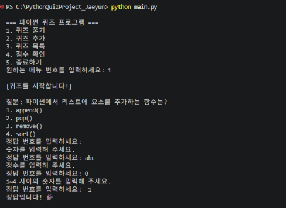
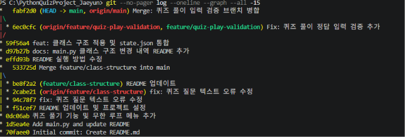

# 🐍 Python Quiz Project

파이썬 기초 공부를 위해 만들고 있는 **퀴즈 게임 프로젝트**입니다.

---

## 📁 프로젝트 구조
```text
PythonQuizProject_Jaeyun/
├── main.py       # 퀴즈 프로그램 실행 파일
├── state.json    # 퀴즈 목록과 점수 기록 저장
├── README.md     # 프로젝트 설명과 테스트 기록
├── .gitignore    # Python 캐시 폴더를 Git 추적에서 제외
└── docs/
    └── screenshots/  # 테스트 및 Git 작업 캡처
```


1. main.py 생성
```
New-Item main.py
```
2. 코드 붙여넣기 후 저장(ctrl+S)
3. uv 설치
```
PS C:\Users\User\Downloads\PythonQuizProject_Jaeyun> powershell -ExecutionPolicy ByPass -c "irm https://astral.sh/uv/install.ps1 | iex"
downloading uv 0.13.7 (x86_64-pc-windows-msvc)
installing to C:\Users\User\.local\bin
  uv.exe
  uvx.exe
  uvw.exe
everything's installed!
```
4. uv version
```
PS C:\Users\User\Downloads\PythonQuizProject_Jaeyun> uv --version
uv 0.13.7 (316c827e0 2026-11-03 x86_64-pc-windows-msvc)
PS C:\Users\User\Downloads\PythonQuizProject_Jaeyun> 
```
5. uv 실행
```
PS C:\Users\User\Downloads\PythonQuizProject_Jaeyun> uv run main.py

=== 파이썬 퀴즈 프로그램 ===
1. 퀴즈 풀기
2. 퀴즈 추가
3. 퀴즈 목록
4. 점수 확인
5. 종료하기
원하는 메뉴 번호를 입력하세요: 1

[퀴즈를 시작합니다!]

질문: 파이썬에서 리스트에 요소를 추가하는 함수는?
1. append()
2. pop()
3. remove()
4. sort()
정답 번호를 입력하세요: 1
정답입니다! 🎉

질문: 파이썬의 창시자는?
1. 빌 게이츠
2. 스티브 잡스
3. 귀도 반 로섬
4. 일론 머스크
정답 번호를 입력하세요: 3
정답입니다! 🎉

질문: 다음 중 파이썬의 특징이 아닌 것은?
1. 배우기 쉽다
2. 오픈 소스이다
3. 느리지만 강력하다
4. 컴파일이 필수다
정답 번호를 입력하세요: 4
정답입니다! 🎉

질문: 파이썬에서 주석을 작성할 때 사용하는 기호는?
1. //
2. #
3. /*
4. --
정답 번호를 입력하세요: 4
틀렸습니다. 정답은 2번입니다. 😢

질문: 파이썬에서 딕셔너리를 만들 때 사용하는 괄호는?
1. []
2. ()
3. {}
4. <>
정답 번호를 입력하세요: 1
틀렸습니다. 정답은 3번입니다. 😢

퀴즈 종료! 당신의 점수는 3/5입니다.
✅ 점수가 저장되었습니다!
---
6. 퀴즈추가
---
=== 파이썬 퀴즈 프로그램 ===
1. 퀴즈 풀기
2. 퀴즈 추가
3. 퀴즈 목록
4. 점수 확인
5. 종료하기
원하는 메뉴 번호를 입력하세요: 2

[새 퀴즈 추가]
질문을 입력하세요: 질문을 입력하세요: 파이썬에서 반복문에 사용하는 키워드는?
1번 보기를 입력하세요: for
2번 보기를 입력하세요: loop
3번 보기를 입력하세요: repeat
4번 보기를 입력하세요: each
정답 번호를 입력하세요 (1~4): 1
✅ 퀴즈가 추가되고 저장되었습니다!

=== 파이썬 퀴즈 프로그램 ===
1. 퀴즈 풀기
2. 퀴즈 추가
3. 퀴즈 목록
4. 점수 확인
5. 종료하기
원하는 메뉴 번호를 입력하세요: 
---
7. 퀴즈 목록
---
=== 파이썬 퀴즈 프로그램 ===
1. 퀴즈 풀기
2. 퀴즈 추가
3. 퀴즈 목록
4. 점수 확인
5. 종료하기
원하는 메뉴 번호를 입력하세요: 3

[퀴즈 목록] 총 6개
1. 파이썬에서 리스트에 요소를 추가하는 함수는?
2. 파이썬의 창시자는?
3. 다음 중 파이썬의 특징이 아닌 것은?
4. 파이썬에서 주석을 작성할 때 사용하는 기호는?
5. 파이썬에서 딕셔너리를 만들 때 사용하는 괄호는?
6. 파이썬에서 반복문에 사용하는 키워드는?(퀴즈추가)
---
8.점수 확인
---
=== 파이썬 퀴즈 프로그램 ===
1. 퀴즈 풀기
2. 퀴즈 추가
3. 퀴즈 목록
4. 점수 확인
5. 종료하기
원하는 메뉴 번호를 입력하세요: 4

[점수 기록] 총 1회 도전
1회차: 3점
최고 점수: 3점
---
브랜치 생성 명령어 
기본 명령어
브랜치 생성만

git branch 브랜치이름
브랜치 생성 + 바로 이동 (가장 많이 사용!)

git checkout -b 브랜치이름
예시

# 브랜치 생성만
git branch feature/class-structure

# 생성 + 이동 동시에
git checkout -b feature/class-structure
README.md파일 브랜치에 저장되어 merge진행

# 브랜치 GitHub에 푸시
git push origin feature/class-structure

# main 브랜치로 이동
git checkout main

# feature 브랜치 병합
git merge feature/class-structure --allow-unrelated-histories

# 충돌 해결 후 스테이징
git add main.py
git checkout --theirs README.md
git add README.md

# 병합 커밋
git commit -m "Merge feature/class-structure into main"

# 최종 푸시
git push origin main

#PR & Merge
📁 pjy0802-source/PythonQuizProject_Jaeyun

⎇ main ▼        ← 이 버튼 클릭!

🔍 Find or create a branch...

Branches
✓ main
  feature/class-structure   ← 이거 클릭!

관련 명령어 모음
명령어	설명
git branch	브랜치 목록 보기
git branch 이름	브랜치 생성
git checkout 이름	브랜치 이동
git checkout -b 이름	생성 + 이동
git branch -d 이름	브랜치 삭제
지금 상황에서는 새 브랜치 생성보다
---

## ⚙️ 개발 환경

- Python 3.12 (uv로 관리)
- Windows 11 / PowerShell
- VS Code
- Git & GitHub

---

## 🎮 주요 기능

| 메뉴 | 기능 |
|------|------|
| 1. 퀴즈 풀기 | 저장된 퀴즈를 순서대로 풀고 점수 확인 |
| 2. 퀴즈 추가 | 새로운 퀴즈를 직접 추가 |
| 3. 퀴즈 목록 | 저장된 퀴즈 전체 목록 확인 |
| 4. 점수 확인 | 지금까지의 점수 기록 및 최고점수 확인 |
| 5. 종료하기 | 프로그램 종료 |

---

## 🚀 실행 방법

### 1. 저장소 클론
```bash
git clone https://github.com/본인아이디/PythonQuizProject_Jaeyun.git
cd PythonQuizProject_Jaeyun
```

### 2. uv 설치
```powershell
powershell -ExecutionPolicy ByPass -c "irm https://astral.sh/uv/install.ps1 | iex"
```

### 3. 프로그램 실행
```powershell
uv run main.py
```

---

## 💻 PowerShell 작업 내역

### 📌 파일 생성 및 실행
```powershell
# main.py 생성
New-Item main.py

# uv 설치
powershell -ExecutionPolicy ByPass -c "irm https://astral.sh/uv/install.ps1 | iex"

# uv 버전 확인
uv --version
# uv 0.13.7 (316c827e0 2026-11-03 x86_64-pc-windows-msvc)

# 프로그램 실행
uv run main.py
```

### 📌 Git 브랜치 작업
```powershell
# 브랜치 생성만
git branch feature/class-structure

# 브랜치 생성 + 이동 (가장 많이 사용)
git checkout -b feature/class-structure

# 브랜치 GitHub에 푸시
git push origin feature/class-structure

# main 브랜치로 이동
git checkout main

# feature 브랜치 병합
git merge feature/class-structure --allow-unrelated-histories

# 충돌 해결 후 스테이징
git add main.py
git checkout --theirs README.md
git add README.md

# 병합 커밋
git commit -m "Merge feature/class-structure into main"

# 최종 푸시
git push origin main
```

### 📌 Git 브랜치 명령어 정리

| 명령어 | 설명 |
|--------|------|
| `git branch` | 브랜치 목록 보기 |
| `git branch 이름` | 브랜치 생성 |
| `git checkout 이름` | 브랜치 이동 |
| `git checkout -b 이름` | 생성 + 이동 |
| `git branch -d 이름` | 브랜치 삭제 |

---

## ✅ 구현 완료 목록

- [x] 메뉴 시스템 (무한 루프)
- [x] 퀴즈 풀기 및 점수 계산
- [x] 퀴즈 추가 기능
- [x] 퀴즈 목록 보기
- [x] 점수 기록 및 최고점수
- [x] JSON 저장/불러오기
- [x] quizzes.json + scores.json → state.json 통합
- [x] 클래스 구조 적용
- [x] GitHub 브랜치 생성 및 병합
## 📁 프로젝트 구조
```
PythonQuizProject_Jaeyun/
├── main.py        # 메인 실행 파일
├── state.json     # 퀴즈 + 점수 통합 저장 파일 (자동 생성)
└── README.md      # 프로젝트 설명서
```
---

## 🔄 state.json 통합 main.py 변경 내역

### 📌 변경 전 (초기 버전)
- 함수 기반으로 작성된 절차적 코드
- `quizzes.json`, `scores.json` 두 파일로 분리 저장

```python
# 함수 기반 구조 예시
def play_quiz():
    ...
def add_quiz():
    ...
def show_scores():
    ...
```

### 📌 변경 후 (클래스 구조 적용)
- `Quiz` 클래스와 `QuizGame` 클래스로 분리
- `state.json` 하나로 퀴즈 + 점수 통합 저장

```python
# 클래스 기반 구조 예시
class Quiz:
    def __init__(self, question, options, answer):
        self.question = question
        self.options = options
        self.answer = answer

    def to_dict(self):
        ...

class QuizGame:
    def load_state(self):   # JSON 불러오기
        ...
    def save_state(self):   # JSON 저장
        ...
    def play_quiz(self):    # 퀴즈 풀기
        ...
    def add_quiz(self):     # 퀴즈 추가
        ...
    def show_quiz_list(self): # 퀴즈 목록
        ...
    def show_scores(self):  # 점수 확인
        ...
    def run(self):          # 메인 루프
        ...
```

### 📌 변경 요약

| 항목 | 변경 전 | 변경 후 |
|------|---------|---------|
| 코드 구조 | 함수 기반 | 클래스 기반 |
| 저장 파일 | quizzes.json + scores.json | state.json 통합 |
| Quiz 표현 | 딕셔너리 | Quiz 클래스 |
| 게임 관리 | 전역 함수 | QuizGame 클래스 |
## 퀴즈 풀이 입력 검증

- 실행 명령은 `python main.py`이다.
- 수정 전에는 빈 입력, `abc`, `0`을 오답으로 처리하고 다음 문제로 넘어갔다.
- 수정 후에는 `read_number()`가 입력의 앞뒤 공백을 제거하고, 1~4 사이의 정수가 들어올 때까지 같은 문제에서 다시 입력받는다.

수정 후 실제 출력

```text
정답 번호를 입력하세요:
숫자를 입력해 주세요.
정답 번호를 입력하세요: abc
정수를 입력해 주세요.
정답 번호를 입력하세요: 0
1~4 사이의 숫자를 입력해 주세요.
정답 번호를 입력하세요:  1
정답입니다! 🎉

질문: 파이썬의 창시자는?
```

### 퀴즈 풀이 브랜치 병합 기록

퀴즈 풀이 입력 검증은 `feature/quiz-play-validation` 브랜치에서 작업했다.
기능 커밋 `6ec0cfc`를 `git merge --no-ff`로 `main`에 병합했고,
병합 커밋 `fabf2d0`이 GitHub의 `main`에 반영됐다.


## 메뉴 입력 검증

메뉴는 `read_number()`를 사용해 1~5 사이의 정수를 입력받는다.
빈 입력, 문자, 범위 밖 숫자는 안내 후 다시 입력받고, 앞뒤 공백은 제거한다.

`python .\main.py` 실행 결과:

```text
원하는 메뉴 번호를 입력하세요:
숫자를 입력해 주세요.
원하는 메뉴 번호를 입력하세요: abc
정수를 입력해 주세요.
원하는 메뉴 번호를 입력하세요: 9
1~5 사이의 숫자를 입력해 주세요.
원하는 메뉴 번호를 입력하세요:  5

프로그램을 종료합니다. 수고하셨습니다! 👋
```
## 퀴즈 추가 입력 검증 및 재실행 확인

- `read_text()`로 빈 질문과 공백만 있는 보기를 다시 입력받는다.
- `read_number()`로 정답 번호를 1~4 사이의 정수로 제한한다.

### 퀴즈 추가 실행 결과

```text
[새 퀴즈 추가]
질문을 입력하세요: 
내용을 입력해 주세요.
질문을 입력하세요:  
내용을 입력해 주세요.
질문을 입력하세요: 파이썬에서 문자열의 길이를 구하는 함수는?     
1번 보기를 입력하세요:  
내용을 입력해 주세요.
1번 보기를 입력하세요: len()
2번 보기를 입력하세요: print()
3번 보기를 입력하세요: input()
4번 보기를 입력하세요: type()
정답 번호를 입력하세요: abc
정수를 입력해 주세요.
정답 번호를 입력하세요: 0
1~4 사이의 숫자를 입력해 주세요.
정답 번호를 입력하세요: 1
✅ 퀴즈가 추가되고 저장되었습니다!
```

### 재실행 후 목록 확인

```text
PS C:\PythonQuizProject_Jaeyun> python .\main.py

=== 파이썬 퀴즈 프로그램 ===
1. 퀴즈 풀기
2. 퀴즈 추가
3. 퀴즈 목록
4. 점수 확인
5. 종료하기
원하는 메뉴 번호를 입력하세요: 3

[퀴즈 목록] 총 6개
1. 파이썬에서 리스트에 요소를 추가하는 함수는?
2. 파이썬의 창시자는?
3. 다음 중 파이썬의 특징이 아닌 것은?
4. 파이썬에서 주석을 작성할 때 사용하는 기호는?
5. 파이썬에서 딕셔너리를 만들 때 사용하는 괄호는?
6. 파이썬에서 문자열의 길이를 구하는 함수는?
```
## 퀴즈·점수 저장 파일 통합

이전 파일에서 반복문 문제와 3점 기록을 `state.json`으로 옮겼다.
기존 `len()` 문제와 4점 기록도 함께 보존했다.
`state.json`의 `quizzes`에는 문제 목록을, `scores`에는 회차별 정답 수를 저장한다.

`python .\main.py` 실행 후 메뉴 3과 4에서 확인한 결과를 발췌했다.

```text
[퀴즈 목록] 총 7개
6. 파이썬에서 문자열의 길이를 구하는 함수는?
7. 파이썬에서 반복문에 사용하는 키워드는?

[점수 기록] 총 2회 도전
1회차: 3점
2회차: 4점
🏆 최고 점수: 4점
```
## 입력 중단 시 안전 종료

`python .\main.py`를 실행해 아래 세 가지 종료 상황을 확인했다.
`KeyboardInterrupt`와 `EOFError`를 처리해 종료 안내를 출력한다.
완료한 퀴즈 등록과 풀이 결과는 저장되며, 입력 중이던 내용은 저장하지 않는다.

### 퀴즈 풀이 중 Ctrl+C

```text
정답 번호를 입력하세요:
입력이 중단되어 프로그램을 종료합니다.
```

### 메뉴에서 Ctrl+Z 후 Enter

```text
원하는 메뉴 번호를 입력하세요: ^Z

입력이 중단되어 프로그램을 종료합니다.
```

### 메뉴 5로 정상 종료

```text
원하는 메뉴 번호를 입력하세요: 5

프로그램을 종료합니다. 수고하셨습니다! 👋
```
## 저장 파일 읽기와 오류 처리

`load_state()`는 프로그램을 시작할 때 `state.json`을 UTF-8로 읽는다.

| 파일 상태 | 처리 방식 |
|---|---|
| 정상 | 퀴즈 목록 `quizzes`와 점수 기록 `scores`를 불러온다. |
| 파일 없음 | 기본 퀴즈 5개와 빈 점수 목록을 준비하고 저장을 시도한다. |
| JSON 형식 오류 또는 읽기 실패 | 안내 메시지를 출력하고 기본 퀴즈로 시작한다. 기존 파일을 보존하기 위해 이번 실행에서는 파일 저장을 막는다. |

`save_state()`가 쓰기 오류를 만나면 안내를 출력한다.
퀴즈 추가와 풀이에서는 파일 저장에 성공했을 때만 저장 완료 메시지를 보여준다.
### 손상 파일 보호 테스트

임시 폴더의 `state.json`에 `{broken json`을 넣고 프로그램을 실행했다.
메뉴 3에서 기본 퀴즈 5개를 확인했고, 메뉴 2에서 퀴즈를 추가해 저장을 시도했다.
저장 차단 안내가 한 번 표시됐고, 종료 후에도 손상 파일의 내용이 유지됐다.

```text
저장 파일을 읽을 수 없어 기본 퀴즈로 시작합니다. 기존 파일은 보존합니다.
[퀴즈 목록] 총 5개
기존 저장 파일을 보호하기 위해 이번 변경은 저장하지 않습니다.

Get-Content -LiteralPath .\state.json
{broken json
```
### 저장 파일 경로 확인

`state.json`의 경로는 `main.py`가 있는 폴더를 기준으로 정한다.
PowerShell에서 임시 폴더로 이동해 실행한 뒤, 메뉴 3과 4에서
프로젝트에 저장된 퀴즈 7개와 최고 점수 4점을 확인했다.
```
PS C:\PythonQuizProject_Jaeyun> $quizScript = (Resolve-Path -LiteralPath .\main.py).Path
PS C:\PythonQuizProject_Jaeyun> Push-Location $env:TEMP
PS C:\Users\User\AppData\Local\Temp> python $quizScript

=== 파이썬 퀴즈 프로그램 ===
1. 퀴즈 풀기
2. 퀴즈 추가
3. 퀴즈 목록
4. 점수 확인
5. 종료하기
원하는 메뉴 번호를 입력하세요: 3

[퀴즈 목록] 총 7개
1. 파이썬에서 리스트에 요소를 추가하는 함수는?
2. 파이썬의 창시자는?
3. 다음 중 파이썬의 특징이 아닌 것은?
4. 파이썬에서 주석을 작성할 때 사용하는 기호는?
5. 파이썬에서 딕셔너리를 만들 때 사용하는 괄호는?
6. 파이썬에서 문자열의 길이를 구하는 함수는?
7. 파이썬에서 반복문에 사용하는 키워드는?

=== 파이썬 퀴즈 프로그램 ===
1. 퀴즈 풀기
2. 퀴즈 추가
3. 퀴즈 목록
4. 점수 확인
5. 종료하기
원하는 메뉴 번호를 입력하세요: 4

[점수 기록] 총 2회 도전
1회차: 3점
2회차: 4점
🏆 최고 점수: 4점

=== 파이썬 퀴즈 프로그램 ===
1. 퀴즈 풀기
2. 퀴즈 추가
3. 퀴즈 목록
4. 점수 확인
5. 종료하기
원하는 메뉴 번호를 입력하세요: 5

프로그램을 종료합니다. 수고하셨습니다! 👋
PS C:\Users\User\AppData\Local\Temp> Pop-Location
PS C:\PythonQuizProject_Jaeyun> 
```
